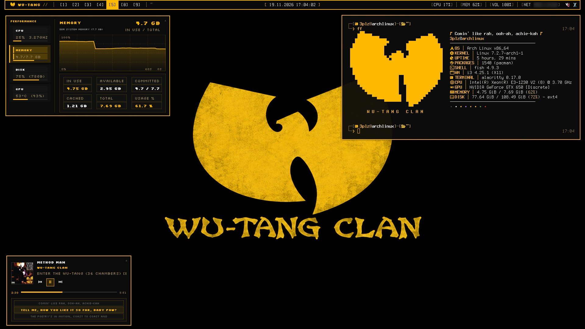
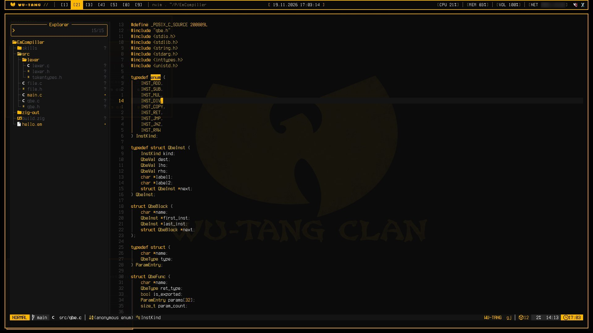
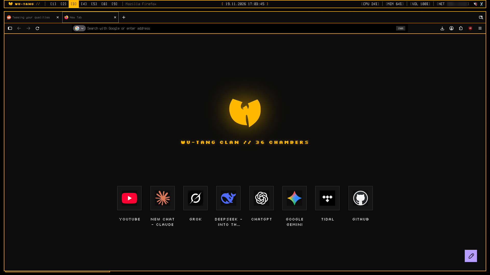
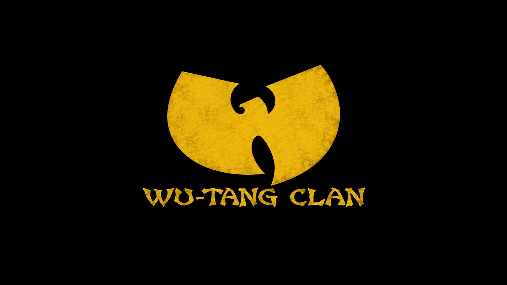
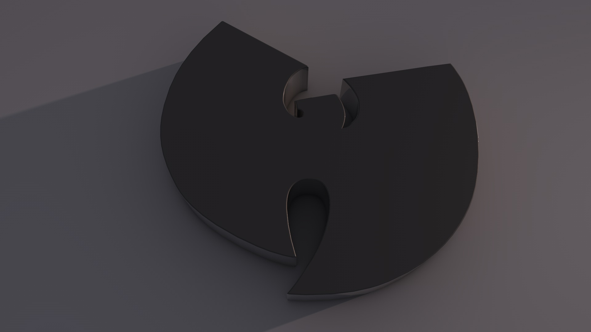
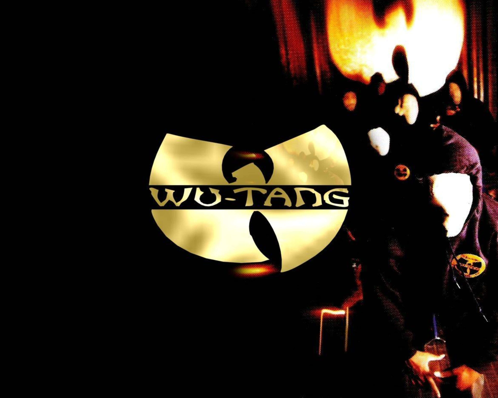
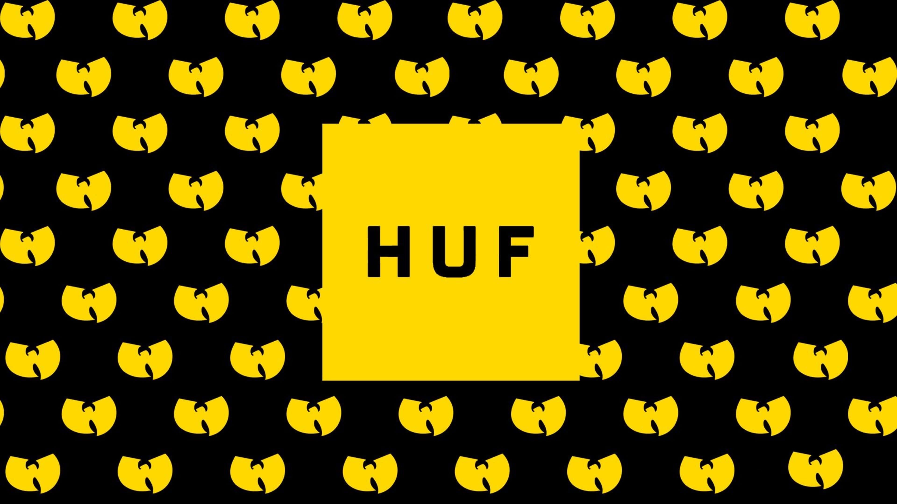
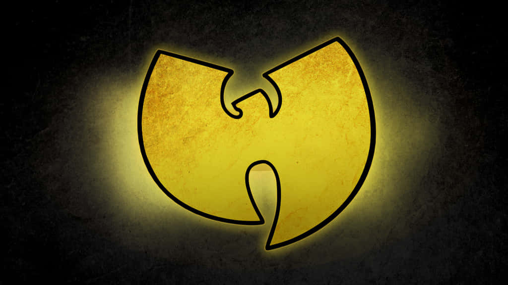
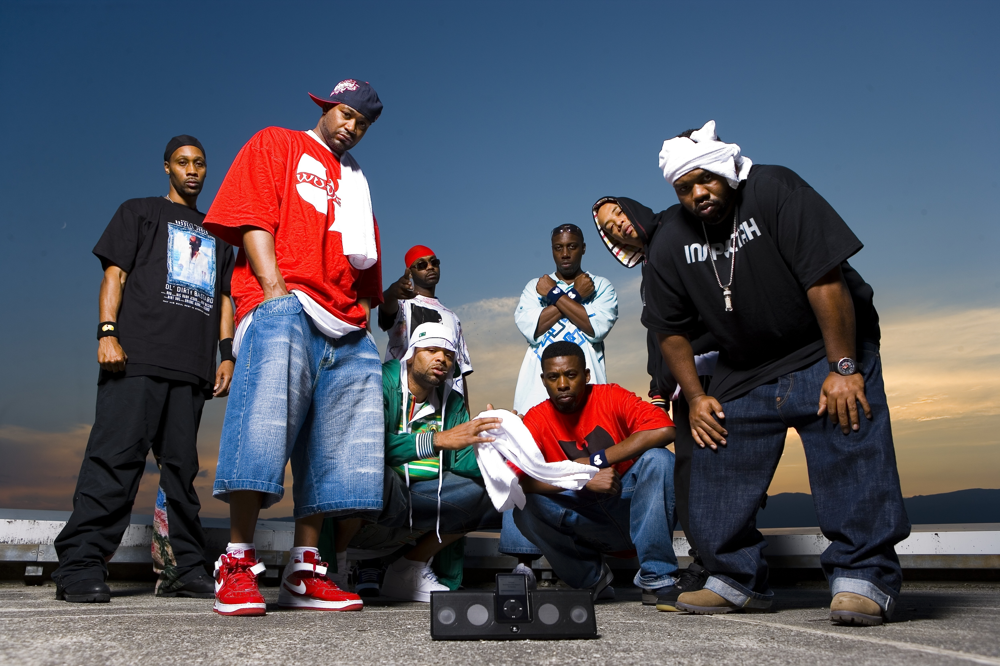

<p align="center">
  
</p>

<h1 align="center">⚡ Wu-Tang Clan Rice // Arch Linux ⚡</h1>

<p align="center">
  <b><i>"Wu-Tang Clan Ain't Nutthin ta Fuck Wit"</i></b><br>
  Aesthetic Pitch Black (<code>#0C0C0C</code>) & Wu-Tang Gold (<code>#FFB800</code>) TUI Dotfiles for i3wm
</p>

<p align="center">
  
  
  
  
  
  
</p>

---

<h2 align="left">📖 About</h2>



<br>

- **OS**: [**`Arch Linux`**](https://archlinux.org/)
- **WM**: [**`i3-wm`**](https://i3wm.org/)
- **Bar**: [**`Polybar`**](https://github.com/polybar/polybar) *(Terminess Nerd Font & Silkscreen modules)*
- **Compositor**: [**`Picom`**](https://github.com/yshui/picom) *(GLX backend, shadows & vsync)*
- **Terminal**: [**`Alacritty`**](https://github.com/alacritty/alacritty) *(Wu-Tang theme, 0.95 opacity)*
- **Shell**: [**`Fish`**](https://github.com/fish-shell/fish-shell) *(2-line prompt with Git status)*
- **Editor**: [**`Neovim`**](https://neovim.io/) *(LazyVim, custom Wu-Tang colorscheme & Lualine)*
- **File Manager**: [**`Thunar`**](https://docs.xfce.org/xfce/thunar/start) *(Wu-Tang TUI GTK3/4 styling, Papirus icons)*
- **App Launcher**: [**`Rofi`**](https://github.com/davatorium/rofi) *(Silkscreen typography & Gold borders)*
- **Notifications**: [**`Dunst`**](https://github.com/dunst-project/dunst) *(Gold frames & Terminess typography)*
- **Desktop Widgets**:
  - [**`SONE Music Widget`**](.config/sone_widget/) *(PyQt5 synced lyrics via playerctl)*
  - [**`Performance Monitor`**](.config/perf_widget/) *(PyQt5 real-time CPU, RAM, Disk, GPU graphs)*
- **Browser**: [**`Firefox`**](https://www.mozilla.org/firefox/) *(about:newtab Wu-Tang dashboard & userChrome.css)*
- **Discord**: [**`Vesktop`**](https://github.com/Vencord/Vesktop) *(Wu-Tang TUI CSS theme)*
- **Display Manager**: **SDDM** *(Shaolin QML Theme)*
- **Fonts**: **Terminess Nerd Font**, **Silkscreen**, **WuTangIcons**

<br clear="right">

---

## 🖼️ Gallery

### 💻 Desktop & Terminal (Alacritty + Fastfetch + Desktop Widgets)


### 📝 Neovim (LazyVim + Custom Wu-Tang Colorscheme + Lualine)


### 🌐 Firefox (Custom about:newtab Dashboard)


---

<details>
<summary><b>🖼️ Wallpapers Collection (Click to expand)</b></summary>
<br>

| Preview | Wallpaper File | Resolution / Style |
|:---:|:---|:---|
|  | [`WuTangClan.png`](wallpapers/WuTangClan.png) | AMOLED Pitch Black (`#000000`) Signature Wallpaper |
|  | [`wu_tang_logo_dark_1080p.jpg`](wallpapers/wu_tang_logo_dark_1080p.jpg) | 1080p Dark Minimal Gold Emblem |
|  | [`wu_tang_group_4k.jpg`](wallpapers/wu_tang_group_4k.jpg) | 4K Group Portrait & Street Artwork |
|  | [`wu_tang_members.jpg`](wallpapers/wu_tang_members.jpg) | Classic Monochrome Band Collage |
|  | [`wu_tang_logo_glowing.jpg`](wallpapers/wu_tang_logo_glowing.jpg) | Glowing Gold Insignia |
|  | [`wu_tang_clan_musicians_den.jpg`](wallpapers/wu_tang_clan_musicians_den.jpg) | Musicians Den Dark Atmosphere |

</details>

---

## 🚀 Features
* **Aesthetic Palette**: High-contrast Pitch Black (`#0C0C0C`) & signature Wu-Tang Gold (`#FFB800`).
* **Zero-Radius Philosophy**: Clean, retro-modern sharp window borders (`border-radius: 0px`) across i3, GTK, Polybar, Rofi, and Firefox.
* **Interactive TUI Installer (`install.py`)**: Pure Python 3 installer with Wu-Tang ASCII header, package progress bar, spinner, and modular component selection.
* **Autonomous Desktop Widgets**: Independent PyQt5 widgets for SONE synchronized lyrics music player and hardware performance metrics with `setsid` daemon detachment.
* **Custom Firefox Dashboard**: Themed `about:newtab` with vector Wu-Tang logo and clean pinned shortcuts.
* **LazyVim Integration**: Handcrafted Wu-Tang colorscheme, custom Lualine statusline, and Snacks dashboard.
* **Centralized Symlink Architecture**: All configs symlinked from `~/.dotfiles` to `~/.config/`, zero hardcoded paths or sensitive credentials.

<table align="center">
   <tr>
      <th align="center">
         <sup>⚠️ RESOLUTION & ENVIRONMENT NOTE ⚠️</sup>
      </th>
   </tr>
   <tr>
      <td align="center">
        This configuration is optimized for <b>1920x1080</b> displays with i3wm, Polybar, and Alacritty.<br>
        All fonts (<i>Terminess Nerd Font</i>, <i>Silkscreen</i>, <i>WuTangIcons</i>) are bundled in <code>fonts/</code> and installed automatically.
      </td>
   </tr>
</table>

---

## 💻 HotKeys

| Shortcut | Action | Target / Command |
|---|---|---|
| `Super + Return` | Open Alacritty terminal | `alacritty` |
| `Super + R` | Application Launcher | `rofi -show drun` |
| `Super + E` | File Manager | `thunar` |
| `Super + B` | Web Browser | `firefox` |
| `Super + D` | Discord Client | `vesktop` |
| `Super + M` | Toggle Music Widget | `~/.config/sone_widget/launch.sh` |
| `Super + P` | Toggle Performance Widget | `~/.config/perf_widget/launch.sh` |
| `Super + Shift + R` | Reload i3 in-place | `i3-msg restart` |
| `Super + Q` | Close focused window | `kill` |
| `Super + Space` | Toggle floating mode | `floating toggle` |
| `Alt + Shift` | Switch keyboard layout | `us,ru` toggle |
| `Print` | Screenshot tool | `flameshot gui` |
| `Super + 1..9` | Switch workspace | Workspace 1–9 |
| `Super + Shift + 1..9` | Move window to workspace | Move to 1–9 |

---

## 📦 Installation & Sync

The repository includes a modern interactive Python 3 TUI installer ([`install.py`](install.py)) with live package progress bars and modular component selection.

### 1. Clone repository
```bash
git clone https://github.com/<your-username>/dotfiles.git ~/.dotfiles
cd ~/.dotfiles
```

### 2. Launch Interactive TUI Installer
```bash
python3 install.py
```

### 3. CLI Batch Modes
```bash
python3 install.py --link-only  # Refresh all symlinks instantly (no pacman calls)
python3 install.py --check      # Run system health diagnostics
python3 install.py --full       # Perform full automated installation
```

---

## 📁 Repository Structure

```
~/.dotfiles/
├── assets/
│   ├── logo.png                # Vector gold Wu-Tang emblem
│   └── screenshots/            # 1080p desktop, neovim & firefox screenshots
├── .config/
│   ├── alacritty/              # Alacritty terminal emulator (Gold & Onyx palette)
│   ├── dunst/                  # Notification daemon (Papirus-Dark, Gold frames)
│   ├── fastfetch/              # Dynamic lyrics fetcher + Wu-Tang logo banner
│   ├── fish/                   # Fish shell 2-line prompt with Git integration
│   ├── gtk-3.0/                # GTK3 Wu-Tang theme & Thunar custom CSS
│   ├── gtk-4.0/                # GTK4 Breeze-Dark configuration
│   ├── i3/                     # i3 window manager config, window rules & autostart
│   ├── nvim/                   # Neovim (LazyVim) with custom Wu-Tang colorscheme
│   ├── perf_widget/            # Hardware monitor widget (CPU, RAM, Disk, GPU graphs)
│   ├── picom/                  # Picom GLX compositor (shadows, vsync, sharp corners)
│   ├── polybar/                # Top status bar with Terminess Nerd Font & Silkscreen
│   ├── rofi/                   # Application launcher styled with Silkscreen & Gold
│   ├── sone_widget/            # Desktop music player widget with synced lyrics
│   └── vesktop/                # Discord (Vesktop) Wu-Tang TUI custom theme
├── firefox/
│   └── chrome/                 # Firefox about:newtab dashboard & userChrome.css
├── fonts/                      # Bundled Terminess, Silkscreen & WuTangIcons
├── wallpapers/                 # AMOLED & Dark Wu-Tang Clan wallpapers
├── .fehbg                      # Wallpaper startup script (feh --bg-fill)
├── .gtkrc-2.0                  # GTK2 dark settings
├── install.py                  # Full TUI installer with live progress bars
└── README.md                   # Repository documentation & preview
```
